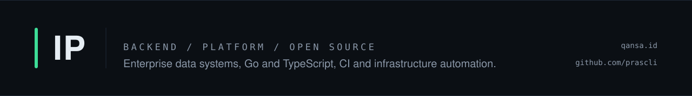

<picture>
  <source media="(prefers-color-scheme: dark)" srcset="assets/banner-dark-v2.svg">
  <source media="(prefers-color-scheme: light)" srcset="assets/banner-light-v2.svg">
  
</picture>

# Indra Prasetya 

### Senior Software Engineer | Backend and Platform Engineering

I am a software engineer working on backend and platform systems. I have been
building software professionally since 2012, most of it in enterprise
environments: data migrations at telecommunications scale, database-heavy
services, and the delivery and monitoring work that keeps them running.

Day to day I work in Go, TypeScript and Python on PostgreSQL. At
[Qansa Solusi Indonesia](https://www.qansa.id) I build systems for clients and
maintain our open-source tooling. The rest of my time goes to developer tools
that remove a measurable cost, which is how
[agentdiet](https://github.com/qansaid/agentdiet) started.

[Email](mailto:indra@qansa.id) |
[LinkedIn](https://www.linkedin.com/in/indraoverflow/) |
[GitHub](https://github.com/prascli) |
[qansa.id](https://www.qansa.id) |
[agentdiet.qansa.web.id](https://agentdiet.qansa.web.id)

---

## Engineering profile

- **Enterprise backend.** Service and data layers for systems where a wrong
  number matters, including customer data migration work for Telkomsel, one of
  Indonesia's largest telecommunications operators.
- **Databases and data movement.** PostgreSQL schema design, migrations,
  reconciliation, and the batch jobs around them.
- **Platform and delivery.** Containerised deployment with Docker and Compose,
  NGINX routing and caching, GitHub Actions pipelines, and release automation.
- **Observability.** Metrics, logs and alerting with Prometheus, Loki, Promtail
  and Grafana, including broker health checks that alert when a Kafka cluster
  degrades.
- **Open source.** Maintaining [qansaid](https://github.com/qansaid), where
  agentdiet and Qansa's tooling live, plus merged fixes to third-party projects
  listed below.

---

## Expertise

**Core.** Go, TypeScript and Node.js, Python, SQL and PostgreSQL, Bash.

**Platform and operations.** Docker and Compose, NGINX, GitHub Actions, Linux,
Git, Kafka with TLS and SASL-SCRAM, Prometheus, Loki, Grafana.

**Working knowledge.** Java and Spring Boot, from reviewed and tested changes
to a Spring Boot ERP codebase (pull requests in review upstream).

**Currently exploring.** Kubernetes, infrastructure as code, distributed
systems patterns, and tooling for AI coding agents.

---

## Flagship projects

### [agentdiet](https://github.com/qansaid/agentdiet)

Every AI coding agent loads its instruction files before it reads your request:
`AGENTS.md`, `CLAUDE.md`, `.cursorrules`, `copilot-instructions.md`. Those files
are paid for on every call, and most repositories never measure them.

agentdiet is a single static Go binary that measures that cost, keeps always-on
context separate from on-demand material, detects verbatim and near-duplicate
guidance, and fails CI when the always-on figure grows. On a simulated
repository it measured 6,770 always-on tokens at grade C and 711 at grade A, an
89.5 percent reduction. No account, no API key, no network call.

Stack: Go, GitHub Actions, Next.js product site. MIT licensed.
[source](https://github.com/qansaid/agentdiet) |
[site](https://agentdiet.qansa.web.id) |
`go install github.com/qansaid/agentdiet@latest`

### [gha-bill](https://github.com/prascli/gha-bill)

CI bills arrive after the cost is committed. gha-bill reads the workflow files
already in a repository and reports cost per workflow, per month, before the
invoice exists.

The interesting part is modelling what GitHub actually charges: per-job minute
rounding, operating system multipliers, and matrix expansion, computed from
triggers and schedules with no API token. Python CLI with a test suite, and a
CI workflow that runs it.

Stack: Python, GitHub Actions, CodeQL.

### [consistency-nginx](https://github.com/prascli/consistency-nginx)

A cache cluster only works when the same key lands on the same node, or the hit
rate collapses. This project builds a working demonstration: an NGINX router
using consistent hashing in front of two cache nodes and a backend, with a
script that proves routing is stable across requests.

Stack: NGINX, Docker Compose, Makefile, Shell.

### Repository status

Facts about each flagship repository, refreshed from the GitHub API.

<!-- PROJECTS:START -->
| Project | Release | Commit | License |
| --- | --- | --- | --- |
| [agentdiet](https://github.com/qansaid/agentdiet) | v0.1.8 | 2 days ago | MIT |
| [gha-bill](https://github.com/prascli/gha-bill) | none | 9 days ago | MIT |
| [consistency-nginx](https://github.com/prascli/consistency-nginx) | none | 5 days ago | MIT |
<!-- PROJECTS:END -->

---

## Other repositories

[kafka-security-ssl-sasl](https://github.com/prascli/kafka-security-ssl-sasl)
and [kafka-monitoring](https://github.com/prascli/kafka-monitoring):
operating a Kafka cluster is two problems, proving a broker is healthy and
seeing what it is doing. The first is a health checker for brokers behind TLS
and SASL-SCRAM, with retries and webhook alerts when a broker fails. The second
is a Compose stack that collects metrics and logs with Prometheus, Loki and
Promtail and visualises them in Grafana. Both are complete and stable rather
than under active development.

[backend-wis-mulai-hidup](https://github.com/prascli/backend-wis-mulai-hidup):
backend for a wedding invitation platform, with invitation and theme modules,
wedding media, transactional email and Prisma migrations on PostgreSQL.
Node.js, Express, TypeScript.

---

## Open source contributions

Merged pull requests into repositories I do not own.

Most of the merged work so far is in an open-source bug-bounty toolkit: fixes to
its installer, its HackerOne MCP integration and its documentation, each one made
after reproducing the failure.

<!-- CONTRIBUTIONS:START -->
- **[Balanov/skein](https://github.com/Balanov/skein)**: 1 merged pull request, latest 2026-11-15
  - fix(engine): return ErrStopped when a stop fences a run in flight ([#2](https://github.com/Balanov/skein/pull/2), merged 2026-11-15)
- **[artivisi/balaka](https://github.com/artivisi/balaka)**: 1 merged pull request, latest 2026-11-15
  - feat(documents): upload several transaction documents in one request ([#57](https://github.com/artivisi/balaka/pull/57), merged 2026-11-15)
- **[gopherium/gophenberg](https://github.com/gopherium/gophenberg)**: 1 merged pull request, latest 2026-11-14
  - Surface dbkit.ErrBusy as 503 database_busy on save deadlock ([#681](https://github.com/gopherium/gophenberg/pull/681), merged 2026-11-14)
- **[cfgaudit/cfgaudit](https://github.com/cfgaudit/cfgaudit)**: 3 merged pull requests, latest 2026-11-14
  - feat(rules): add CFG137 for text hidden behind long runs of blanks (#1718) ([#1758](https://github.com/cfgaudit/cfgaudit/pull/1758), merged 2026-11-14)
  - fix(CFG056): do not treat including and -thing nouns as narrowing ([#1757](https://github.com/cfgaudit/cfgaudit/pull/1757), merged 2026-11-14)
  - fix(CFG119): skip interpreter version arguments and flag values ([#1725](https://github.com/cfgaudit/cfgaudit/pull/1725), merged 2026-11-14)
- **[lingdojo/kana-dojo](https://github.com/lingdojo/kana-dojo)**: 1 merged pull request, latest 2026-11-14
  - content: add learner mistake 1037 ([#34105](https://github.com/lingdojo/kana-dojo/pull/34105), merged 2026-11-14)
- **[pulseaiclub/phi](https://github.com/pulseaiclub/phi)**: 1 merged pull request, latest 2026-11-14
  - docs: sync README.zh-CN.md with English README ([#528](https://github.com/pulseaiclub/phi/pull/528), merged 2026-11-14)
<!-- CONTRIBUTIONS:END -->

Also credited: [garrytan/gstack#4085](https://github.com/garrytan/gstack/pull/4085),
merged 2026-11-06, where my work appears as a `Co-authored-by` trailer on commit
[5e2964d](https://github.com/garrytan/gstack/commit/5e2964d). The pull request
belongs to the maintainer, so it does not appear in the generated list.

---

## Engineering practice

- **Measure the cost before optimising it.** Token budgets, CI spend and broker
  health all start as numbers nobody looked at.
- **Keep failures visible.** Services that report staleness, truncation and
  partial results are easier to operate than services that only report success.
- **Automate the repeatable part.** Migrations, releases and health checks
  should behave the same at 03:00 as they do on a laptop.
- **Write the documentation with the change.** A tool nobody can install is not
  shipped, which is why each repository above carries run and verify steps.
- **Prefer the smallest design that survives production.** Fewer moving parts
  means fewer things to get paged about.

---

## Current focus

- Kubernetes and infrastructure as code, moving from Compose-based deployment
  toward declarative platforms.
- Tooling for AI coding agents, starting with context cost in agentdiet.
- Observability at the level of individual services, not only host metrics.
- Distributed systems patterns, currently consistent hashing and cache routing.

---

## Activity

<!-- STATS:START -->
| Metric | Value |
| --- | --- |
| Contributions, last 12 months | 590 |
| Commits, last 12 months | 257 |
| Pull requests opened, last 12 months | 117 |
| Private contributions, last 12 months | 144 |
| Merged pull requests authored, all time | 81 in 24 repositories |
| Merged upstream, all time | 24 in 16 repositories |

_Refreshed 2026-11-15 from the GitHub API._
<!-- STATS:END -->

<a href="https://github.com/prascli">
  <picture>
    <source media="(prefers-color-scheme: dark)" srcset="https://streak-stats.demolab.com?user=prascli&theme=dark&hide_border=true&short_numbers=true">
    <source media="(prefers-color-scheme: light)" srcset="https://streak-stats.demolab.com?user=prascli&theme=default&hide_border=true&short_numbers=true">
    
  </picture>
</a>

---

## Contact

- Email: [indra@qansa.id](mailto:indra@qansa.id)
- LinkedIn: [Indra Prasetya](https://www.linkedin.com/in/indraoverflow/)
- GitHub: [@prascli](https://github.com/prascli)
- Company: [Qansa Solusi Indonesia](https://www.qansa.id)
- Product: [agentdiet.qansa.web.id](https://agentdiet.qansa.web.id)

Open to remote backend and platform engineering work.
